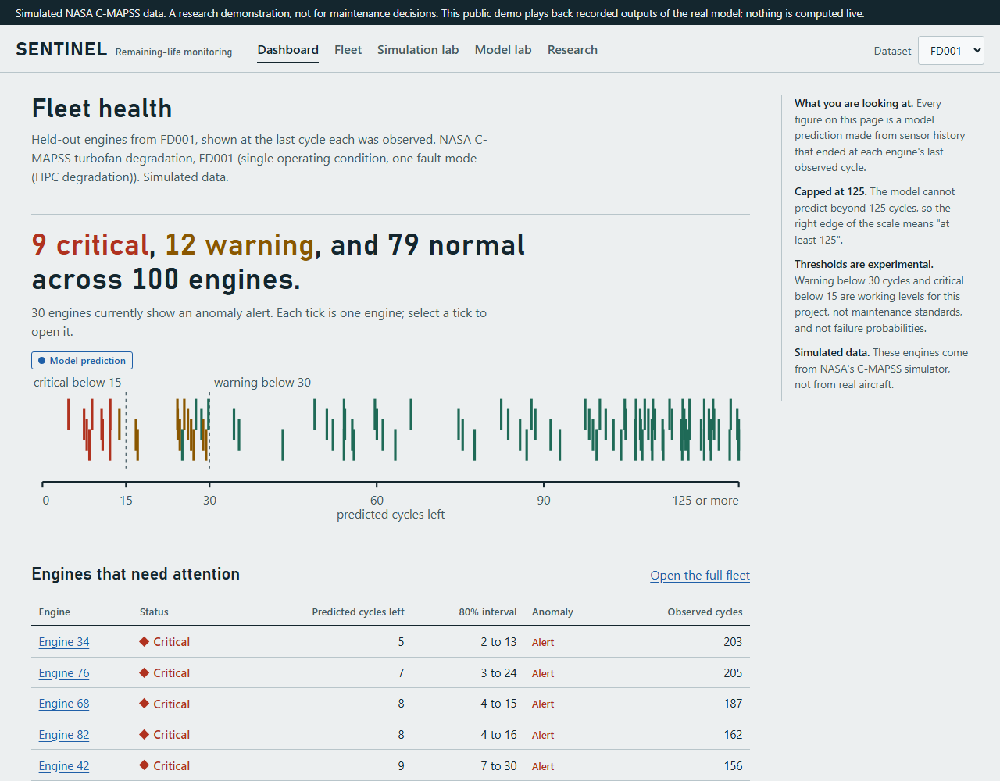
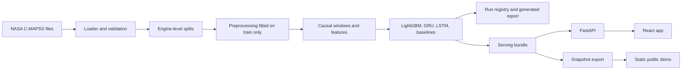
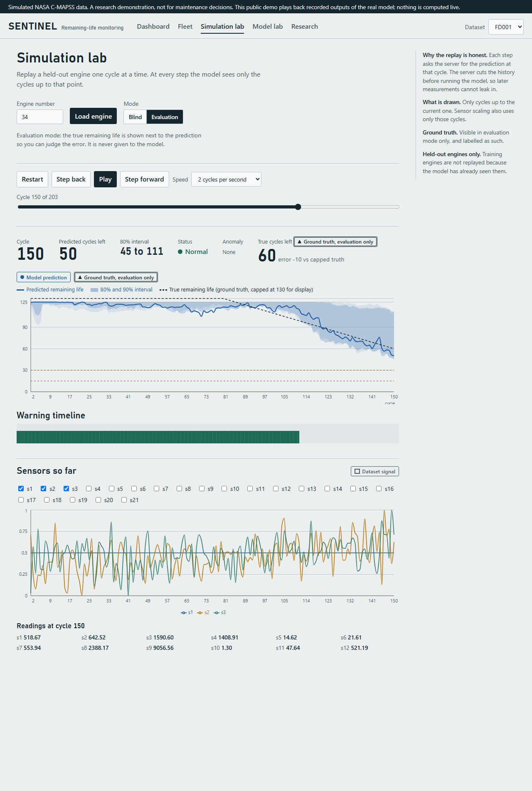

# SENTINEL: predictive maintenance with honest evaluation

SENTINEL estimates how many operating cycles a machine has left, raises warnings, flags unusual sensor behaviour, says how uncertain it is, and explains its predictions. It is a machine-learning engineering project built on NASA's simulated C-MAPSS turbofan data, and its main deliverable is an evaluation you can trust: engine-level splits, test sets used once, confidence intervals, negative results kept, and every claim tied to a run record.

> **Research demonstration on simulated data. Not for maintenance decisions.** Limits are listed below and in [docs/LIMITATIONS.md](docs/LIMITATIONS.md).



## The problem, and why it matters
Servicing a machine too early wastes useful life; too late risks failure. Maintenance planning needs a remaining-useful-life (RUL) estimate that is accurate when it matters, honest about its uncertainty and checkable. Predictive-maintenance projects most often fail at evaluation (leakage between train and test, tuning on the test set, one lucky number), so this project treats evaluation as the product.

## How it works
1. **Data:** C-MAPSS run-to-failure engines (four subsets of increasing difficulty). Preprocessing is fitted on training engines only, with sensors normalised per operating regime.
2. **Prediction:** a causal window of the last 50 cycles feeds a model that predicts RUL (capped at 125). Models compared: constant, Ridge, Random Forest, LightGBM, GRU, LSTM.
3. **Failure intelligence:** warning levels from predicted RUL, a statistical anomaly detector, 80% and 90% prediction intervals (conformal), and exact SHAP explanations.
4. **Application:** a FastAPI service and a React app with a replay lab in which the model sees only the cycles up to now. Every figure is labelled as a prediction, ground truth, dataset signal or recorded benchmark.



Machines are described by a config (`configs/*.yaml`): the pipeline reads columns only from it, so the same code ran on a second, non-engine dataset (lithium-ion batteries) as a small demonstration. A trained model does not carry over to a different machine; the method does.

## Data and method
- **Data:** NASA C-MAPSS FD001-FD004 (simulated; 100-260 training and 100-259 test engines per subset). See [docs/DATASET_CARD.md](docs/DATASET_CARD.md). The files are downloaded, not redistributed.
- **Splits:** development by engine id (grouped 5-fold CV); the official test sets are evaluated once per final configuration. Hyperparameters are fixed defaults (nothing tuned on the test set).
- **Leakage controls, all tested:** no engine on both sides of a split, fit-on-train preprocessing, causal windows (changing later rows does not change earlier predictions), ground truth never passed to a model.
- **Metrics:** RMSE, MAE, the NASA asymmetric score, bootstrap 95% intervals; warning precision/recall/lead time; interval coverage; fit time, latency and size. Full protocol: [docs/EVALUATION_PLAN.md](docs/EVALUATION_PLAN.md).

## Results (official test sets)
| Dataset | Conditions / faults | LightGBM test RMSE (cycles) | 95% CI | Constant guess |
|---|---|---|---|---|
| FD001 | 1 / 1 | 13.75 | 11.6-15.6 | 43.1 |
| FD002 | 6 / 1 | 24.50 | 21.3-27.3 | 54.1 |
| FD003 | 1 / 2 | 13.88 | 11.1-16.4 | 45.1 |
| FD004 | 6 / 2 | 25.65 | 22.8-28.2 | 54.9 |

What the evidence supports (details and caveats in [docs/EXPERIMENTS.md](docs/EXPERIMENTS.md); the generated [reports/REPORT.md](reports/REPORT.md) is the source of truth):
- Operating conditions, not fault modes, drive difficulty; per-regime normalisation is essential on the six-condition subsets.
- LightGBM, Random Forest, GRU and LSTM are statistically indistinguishable on these test sets (FD001: 13.8, 14.8, 15.2, 16.1). LightGBM is the default because it is as good and far cheaper (about 3 s to train versus minutes for the recurrent networks), not because the others were shown to be worse. Deep models were tried on FD001 only, untuned.
- Warnings (30-cycle level, FD001, out-of-fold): precision 0.97, recall 0.83, median 25 cycles of notice; recall is lower on the test set.
- Raw quantile intervals badly under-cover (nominal 80% covered 50-62%); conformal calibration restores the average, but coverage is weakest in mid-life.
- Anomaly detection is evaluated on injected faults only: large noise bursts and level shifts are caught, a stuck sensor is not.
- Models trained on single-condition data fail on six-condition data (RMSE 56-61, worse than a constant guess).



More screenshots: [engine page with explanation](docs/images/engine.png), [fleet explorer](docs/images/fleet.png), [model lab](docs/images/model-lab.png), [phone layout](docs/images/dashboard-mobile.png).

## Demo
- **Run it locally** (below): the full app with the live API.
- **Public static demo:** the app can also be built as a static site that plays back recorded outputs of the real model (no server, nothing computed live): `python scripts/export_snapshot.py` then `cd web && npm run build:demo`. A GitHub Pages workflow is included (`.github/workflows/pages.yml`); the demo has not been published yet. The recording is checked against the live API in `scripts/run_e2e.py`.

## Installation
Python 3.12 and Node 20 or newer. On Windows PowerShell use `npm.cmd` if script execution is disabled.
```bash
git clone <this repository> && cd sentinel
python -m venv .venv && source .venv/bin/activate        # Windows: .venv\Scripts\activate
pip install -e ".[all]"                                   # core, deep learning, SHAP, API and test dependencies
python scripts/fetch_data.py                              # NASA C-MAPSS (about 12 MB), size and SHA-256 verified
python scripts/build_bundle.py                            # serving models for all four subsets (a few minutes)
python -m pytest -q                                       # 166 tests

uvicorn sentinel.api.app:app --port 8000                  # API (docs at /docs)
cd web && npm install && npm run dev                      # app at http://localhost:5173
```
A fresh clone was installed and tested in a clean environment before release (see [docs/TESTING.md](docs/TESTING.md)).

Reproduce the experiments (each writes run records to `experiments/runs/` and reports to `reports/`):
```bash
python scripts/run_baselines.py --subset FD001            # baselines, LightGBM and ablations (also FD002-FD004)
python scripts/run_sequence.py --subset FD001             # GRU and LSTM
python scripts/run_warning.py; python scripts/run_anomaly.py; python scripts/run_uncertainty.py; python scripts/run_explain.py
python scripts/run_transfer.py; python scripts/make_report.py
```
Optional second dataset: `python scripts/fetch_data.py --battery` then `python scripts/run_battery.py`.

## Repository map
`src/sentinel/` pipeline, models, evaluation, inference bundle and API · `web/` React app · `scripts/` experiments, report, benchmark, demo export · `configs/` dataset specs · `experiments/` run records and splits · `reports/` generated reports and figures · `tests/` Python tests · `docs/` plans, cards, case study.

## Documentation
[Case study](docs/CASE_STUDY.md) · [Interview guide](docs/INTERVIEW_GUIDE.md) · [Experiments](docs/EXPERIMENTS.md) · [Model card](docs/MODEL_CARD.md) · [Dataset card](docs/DATASET_CARD.md) · [Limitations](docs/LIMITATIONS.md) · [Testing and quality](docs/TESTING.md) · [API](docs/API.md) · [Architecture](docs/ARCHITECTURE.md) · [Roadmap](docs/ROADMAP.md) · [Risk register](docs/RISK_REGISTER.md) · [API performance](reports/performance.md)

## Limitations
Simulated data only; no real machine. No hyperparameter tuning, and deep learning tried on one subset. Intervals are calibrated on average, not at every RUL. Anomaly accuracy is known only for injected faults. SHAP describes the model, not the machine. The battery result is four cells with no test set and a project-defined end of life. No authentication, monitoring or drift handling; benchmarks are from one laptop CPU. Full list: [docs/LIMITATIONS.md](docs/LIMITATIONS.md).

## Future work
A real, larger run-to-failure dataset (for example bearings, which need a signal-feature step); tuned sequence models on the harder subsets; handling of machines that have not failed (censoring); temporal anomaly features so stuck sensors are detectable; explicit costs of a miss versus a false alarm before fixing warning thresholds.

## Data attribution
NASA C-MAPSS: A. Saxena, K. Goebel, D. Simon, N. Eklund, "Damage Propagation Modeling for Aircraft Engine Run-to-Failure Simulation", PHM08, 2008. NASA Prognostics Center of Excellence battery data set for the second-machine demonstration. No licence terms are stated by the source; the data are not included in this repository.
